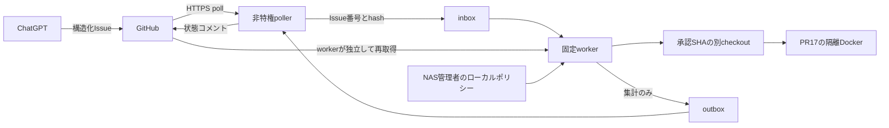

# 設計・信頼境界

対象はIssue #18。基準main `178855fd117301131c8e3ebf70ce8c5e9e327728` から独立ブランチを作成し、PR #17をマージしない。今回は開発のみで、実NASへの導入は別承認とする。

## 受付と承認

Issueタイトルは `[NAS-JOB]` または `[NAS-JOB] ASCIIの識別子`、本文はJSONのみ。schema_version/job_id/job_type/commit_sha/raceday/input_id/expires_at/scope以外のキー、重複キー、任意shell/URL/パス/環境変数/Docker引数を拒否する。input_idは管理者側の固定パス辞書への識別子であり、パスではない。

workerはspool内の内容を実行命令として信用せず、固定repoのGitHub APIからIssueを取り直す。作成者の数値account IDをローカルallowlistと照合し、repo owner IDまたはGitHubのrepository permission（write/admin）を確認する。認証/権限確認ができなければ実行しない。Issueのラベル、本文の自己申告、author_associationだけでは承認しない。

request_hashはrepo・Issue番号・数値requester ID・正規化した全ジョブJSONを束ねたSHA256。初期は管理者がinspectで確認し、そのhashをローカルpolicyへ個別承認する。globalの許可type/SHA/入力と個別hashの両方が必要。新コード/Dockerfile/依存/実行方式は固定SHAまたは導入agent自体の新規レビュー対象で、自動更新しない。

後続のgrantsは既に許可されたSHA/type/input/date範囲にだけ限定する。初回観測時にcreated_atとupdated_atが異なるIssueは保守的に個別承認を要求する。以後意味のある本文変更を検知したIssueはgrantを使わず再承認する。空白等で正規化JSONが同一なら同じ依頼。RUNNING時の変更は実行パラメータに反映しない。終端済みjob_idは別Issue/本文でも再使用不可で、新job_idが必要。

## 実行/停止/報告

OSファイルロックでworkerを1個に限定し、私有SQLiteにjob_id/hashと状態履歴を保存する。QUEUED、WAIT_APPROVAL、RUNNING、SUCCEEDED、FAILED、CANCELLED、INTERRUPTEDを記録する。短いhealthcheckでもGitHubの結果コメントに状態履歴が含まれる。Issue closeはキャンセル。期限切れは開始せず、実行中に期限/制限時間/許可時間帯を越えたら停止する。

電源断・異常終了後に残るRUNNINGはINTERRUPTEDへ変える。issue16_acceptanceは後続ジョブ全体を管理者確認まで止める。Dockerのbuildはクライアント停止後もdaemon側に残り得るため、コンテナ停止とbuild idleの確認を自動成功と扱わない。ack-interruptedは該当instanceの残存containerなしと管理者の明示確認を要求し、中断ジョブそのものは再実行しない。

GitHubへの報告はpollerが別途実行する。POST保存後の応答喪失時は自分のmarkerコメントを再発見してPATCHし、同じジョブを再実行しない。ローカル保存結果を再送できる。RUNNING heartbeatは15秒間隔でローカル保存、GitHubの更新は5分間隔。未応答/古いheartbeatはNAS電源OFF・通信/サービス停止等を含み、FAILEDとは断定しない。初期pollは60秒、ETag、Retry-After/RateLimit-Reset、指数backoffを使い、待機期限は再起動後にも維持する。

## PR #17の再利用と権限

target checkoutは固定HTTPS repoから40桁SHAでGit取得し、HEAD/remote/clean状態/余分なignored fileなしを検証する。初期SHAは `3ae9ce0dc5eaf41c2aa5d26c6e62fcef8dc26b92`。sourceと依存venv、秘密、状態、snapshot、出力は別のルート。

固定host helperはそのcheckoutの `nas.workspace.initialize`、`nas.launch.checked_environment`、`verify_archive`、`nas.candidate.verify_completed`、任意のWindows比較には `nas.compare.compare` を直接使用する。予想/順位/買い目を再実装しない。既存CLIは固定project名でリソースoverrideの引数を持たないため、同じパス検査APIとcomposeを使う最小host wrapperで、instance/job固有projectと管理者固定の制限を付ける。

実行前に展開済みComposeを検査し、snapshot/markerはro、候補runsだけrw、network none、非root、read_only、cap drop、no-new-privileges、socket/秘密/host namespaceなしを要求する。job指定のcomposeは受け付けない。CPU/RAM/PIDの例は1 CPU/2GiB/256。worker自身にも専用サービスのCPU/メモリ制限を設定できる。buildは実行と別の信頼境界で、allow_buildの明示承認と非重複時間帯が必要。

**build daemonのCPU/メモリは通常のCompose実行制限やworkerのsystemd制限の対象外**。本開発でNAS上のbuild資源制限は実証していない。単一実行・時間帯・全体timeout・失敗後の再実行停止を実装するが、導入承認前にNASの実測で十分な余力または専用build用cgroup/builderの上限を確認する。満たせなければallow_build=falseを維持し実機受入は保留する。

本番は固定のソース/モデル/非秘密設定/指定原本/正式READY・STATUSのhashと、コンテナID/image/mount/restart/user/runningを前後照合する。秘密ファイル・Env・health logを取得しない。正常な既存定期処理による変化も失敗として検出し、原因を報告するだけで復元/停止しない。これは全ホスト状態の不変証明ではない。

## 脅威と残る境界

| 入力/権限 | 防御/限界 |
|---|---|
| 他人がIssue/ラベルを変更 | 独立GET、数値ID/権限、厳格schema、承認hash/固定範囲。ラベルを承認根拠にしない |
| pollerの侵害 | Dockerグループなし、受付socketなし、worker私有state/policy/checkoutへ書込不可。workerはGitHubから再取得。spoolの不正値/リンク/非通常ファイルを拒否 |
| 任意SHA/任意path | ローカルallowlistと固定input辞書、専用ルート、PR17パス検査。global範囲外は個別hashを追加しても実行不可 |
| worker/管理者の侵害 | Docker権限は実質root相当。ここは信頼する境界であり、任意コードsandboxではない。agent code・policy・新規SHAの管理者レビューとOS所有権が必要 |
| build/上流依存 | 承認SHAのDockerfile/依存だけをbuild。contextにPAT/本番dataを置かない。PR17のbase tagと依存の供給網・NAS実測は別途確認が必要 |
| 結果漏えい | 数値/固定enum/versionと成果物SHAだけをallowlist送信。Excel/オッズ/馬別結果/生ログ/秘密/ホストpathは送らない。Driveは常にdry-run |
| GitHub停止/公開Issue spam | fail closed/backoff。ページ/ファイル/本文サイズ上限あり。可用性の完全保証はしない。権限やTailscaleを緩和しない |

認証はrepo限定fine-grained PAT。pollerはIssues read/write、Contents read、Metadata read。workerは公開repo ownerのみなら無認証readも可能だがrateが小さいため、長い受入には別のIssues read/Contents read/Metadata read tokenを推奨する。workerへIssues writeは不要。実権限/可視性はverify-githubと初回health報告で確認する。

参考: [PAT管理](https://docs.github.com/en/authentication/keeping-your-account-and-data-secure/managing-your-personal-access-tokens)、[repository permission API](https://docs.github.com/en/rest/collaborators/collaborators#get-repository-permissions-for-a-user)、[REST API運用](https://docs.github.com/en/rest/using-the-rest-api/best-practices-for-using-the-rest-api)、[self-hosted runner等の信頼境界](https://docs.github.com/en/actions/reference/security/secure-use)。一般的なself-hosted Actions runnerは導入しない。
